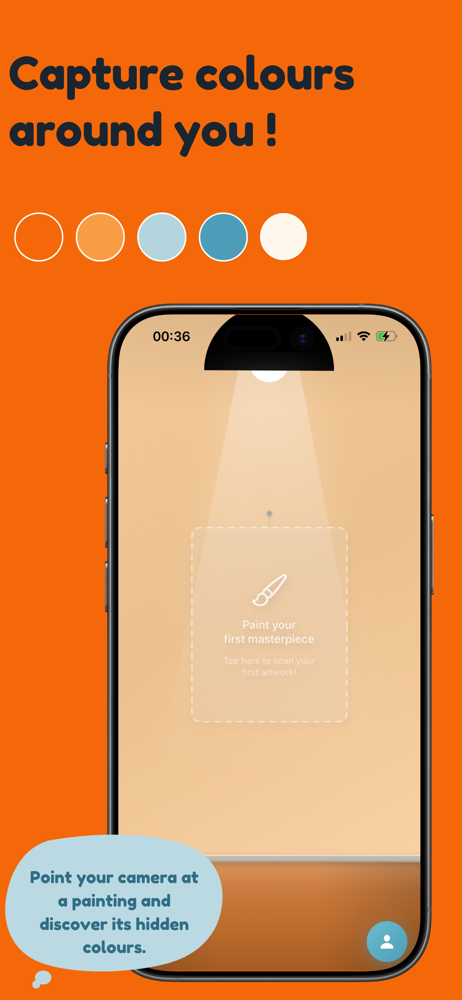
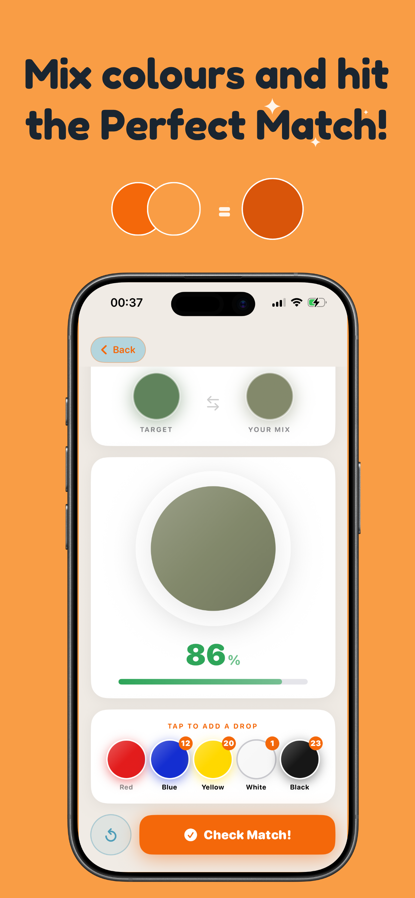
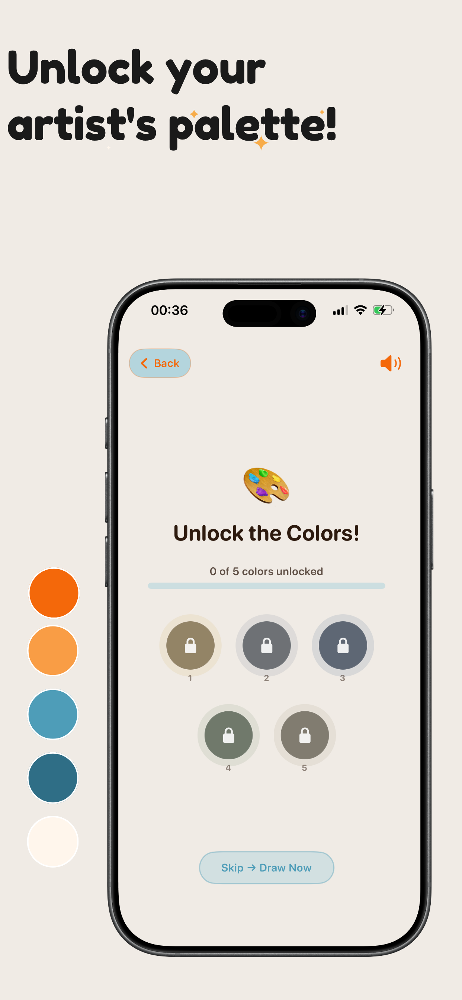
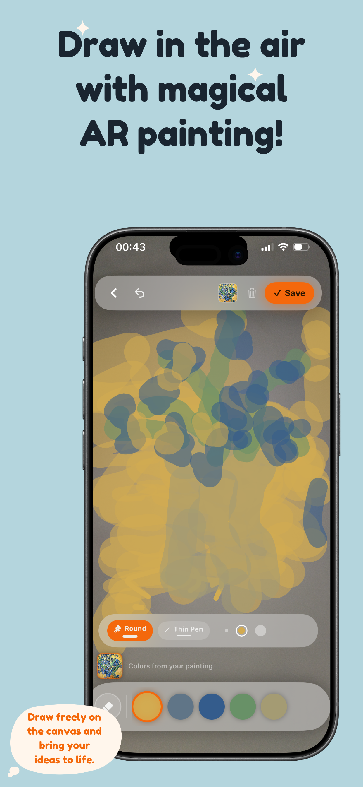
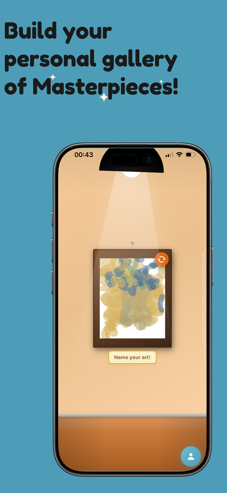
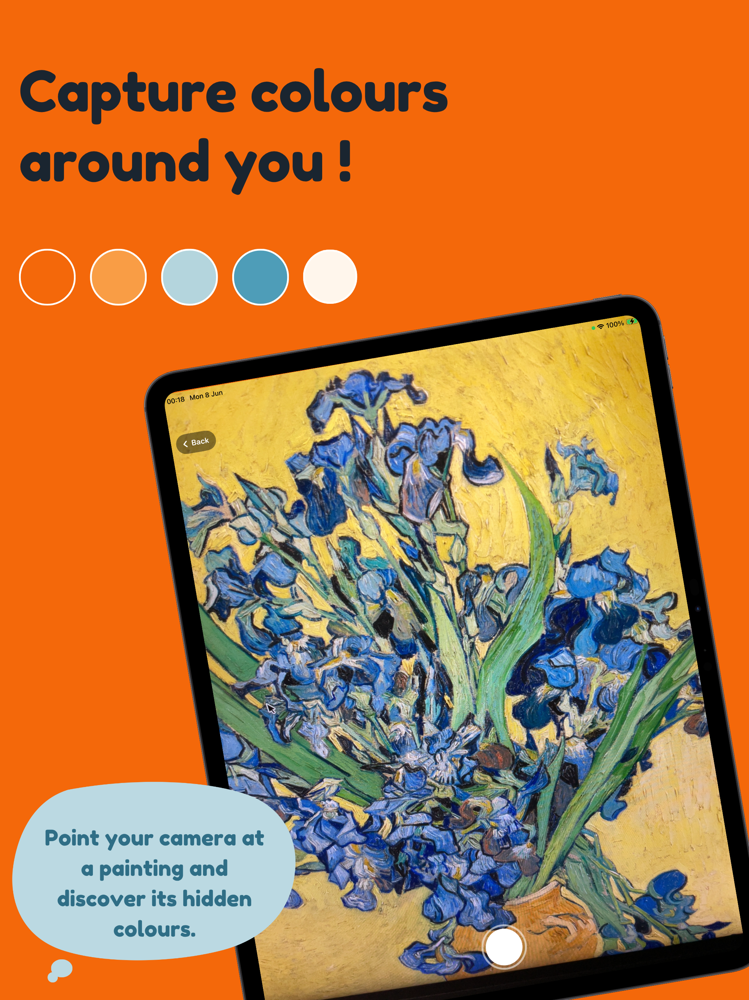
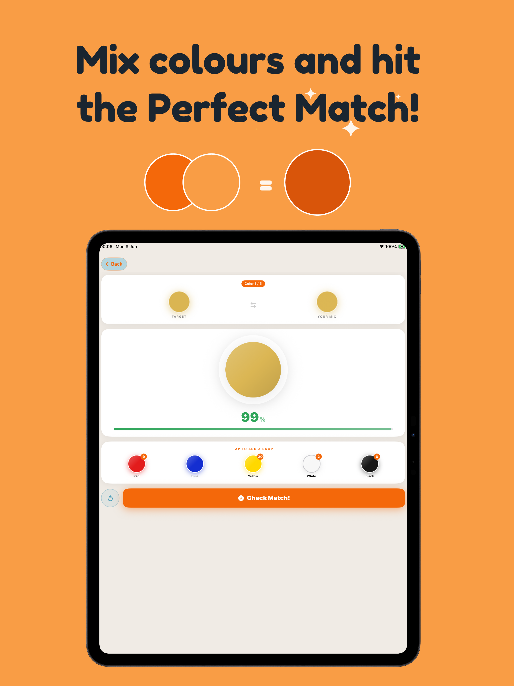
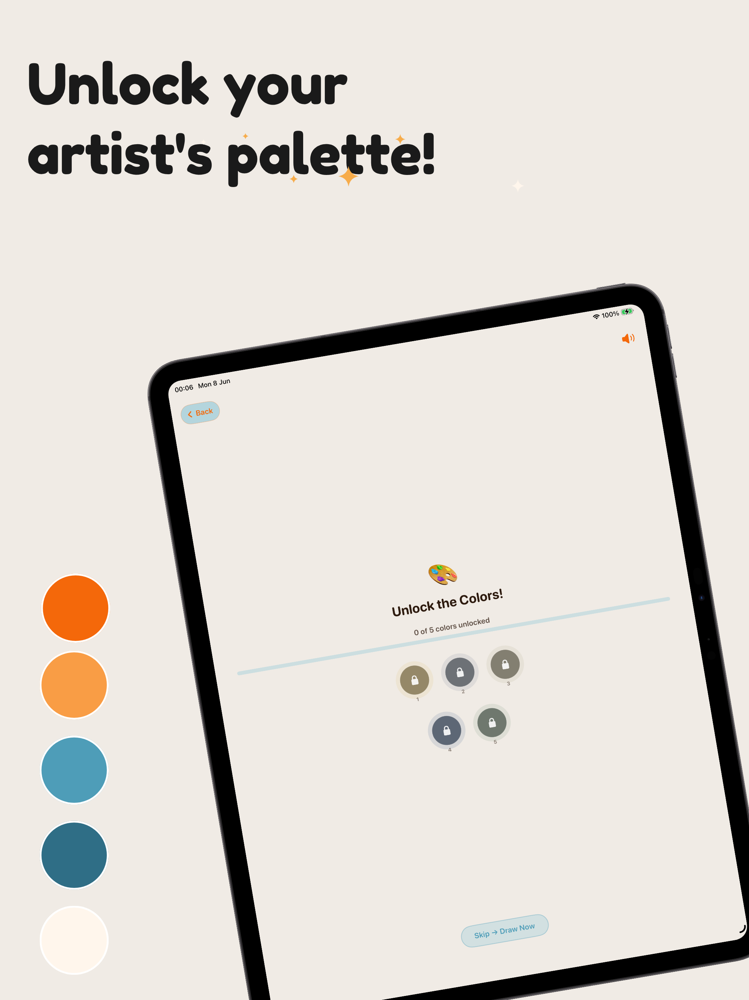
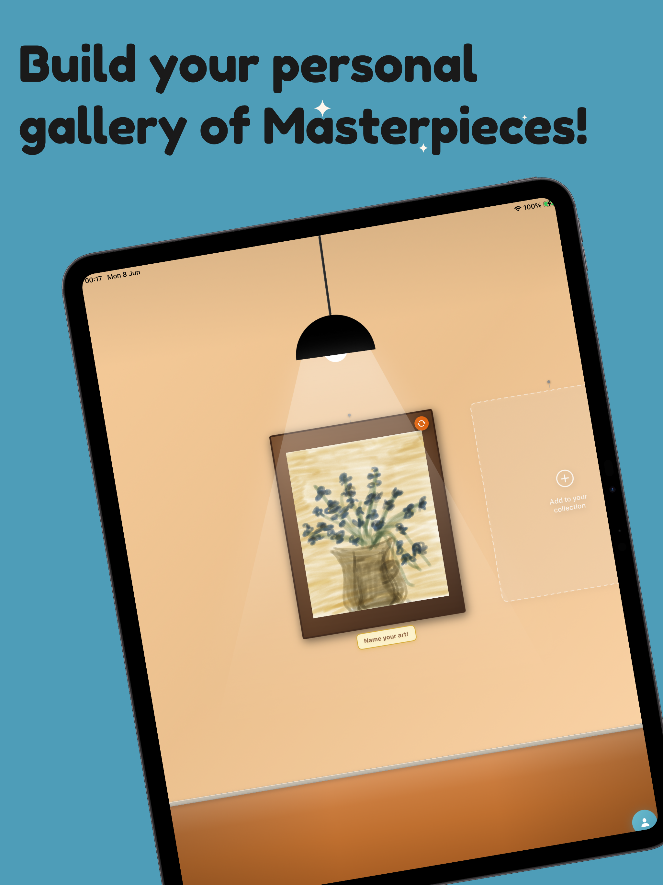

# Tinto
### Your Museum Buddy

**Every painting hides a palette. Tinto helps kids find it, and paint with it.**

For young artists aged 6–11 · iPhone & iPad · iOS 16+ · English & Italian

---

---

## 🎨 How it works

<table>
  <tr>
    <td align="center" width="25%"><h3>📷</h3><b>1. Scan</b> Point the camera at any artwork in the museum.</td>
    <td align="center" width="25%"><h3>🌈</h3><b>2. Discover</b> Tinto reveals the painting's main colors and its art style.</td>
    <td align="center" width="25%"><h3>🧪</h3><b>3. Mix</b> Mix red, yellow, blue, white and black to unlock each color.</td>
    <td align="center" width="25%"><h3>🖌️</h3><b>4. Create</b> Paint your own masterpiece with the colors you won.</td>
  </tr>
</table>

---

## ✨ Features

**🎯 Mix to unlock**
A color-mixing mini-game: match the target color to add it to your palette. Stars, streaks and a little celebration when you get it right.

**✋ Paint in the air**
With the AR canvas, your hand becomes the brush. Or paint on the touch canvas with a finger or Apple Pencil.

**🖼️ Your own museum**
Every painting is saved on a gallery wall, next to a photo of the artwork that inspired it.

**🏅 Badges**
Earn milestones like First Painting, Color Master and Gallery Star.

**📤 Share**
Send one painting or your whole gallery to family and friends.

**🌍 English & Italian**
Switch language right inside the app.

**🧑‍🎨 Make it yours**
Pick an avatar, a name, and light or dark appearance.

---

## 📱 Made for iPad too

---

## 🔒 Safe for kids

- No accounts, no sign-in
- No analytics
- Paintings, photos and progress stay on the device

---

**Tinto** · Built with Swift & SwiftUI

Main project repository: [fatima-shekarabi/Tinto-Project](https://github.com/fatima-shekarabi/Tinto-Project) (private)

